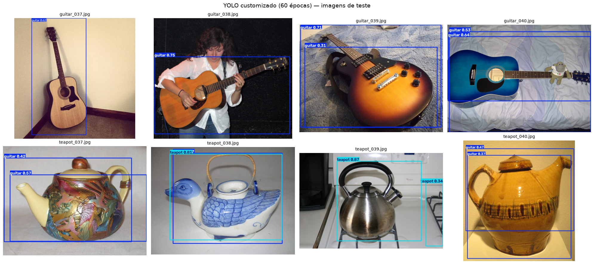
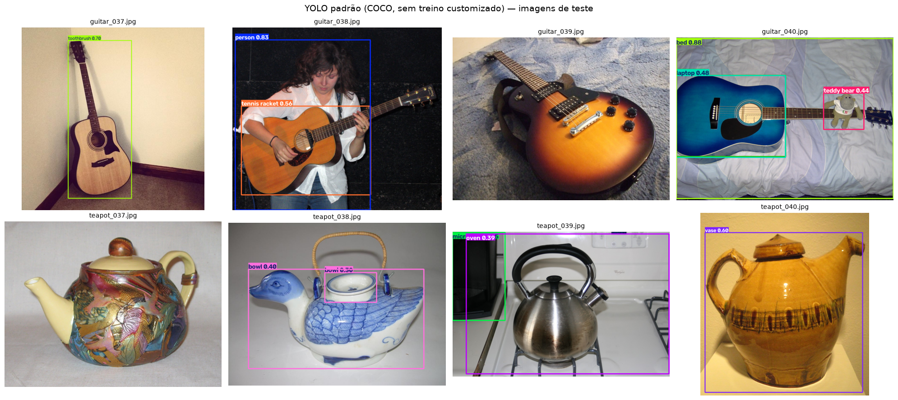
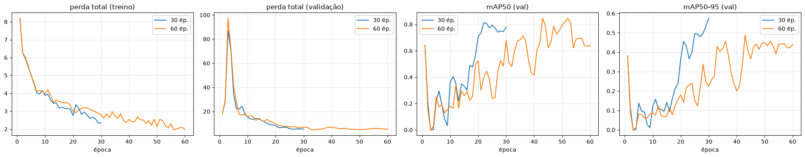

# PBL Fase 6: Visão Computacional com YOLO

**Aluno:** Nelson Henry Campos | **RM:** 573230 | **Curso:** FIAP

Detecção e classificação de 2 objetos visualmente distintos, **violão/guitarra (`guitar`)** e **bule/chaleira (`teapot`)**, comparando três abordagens:

1. **YOLO customizado**: fine-tuning do YOLO11n com 30 e 60 épocas;
2. **YOLO padrão**: YOLO11n pré-treinado no COCO, sem treino;
3. **CNN do zero**: classificador em PyTorch, sem pesos pré-treinados.

## Links

- 📓 **Notebook:** [`NelsonHenryCampos_RM573230_pbl_fase6.ipynb`](NelsonHenryCampos_RM573230_pbl_fase6.ipynb) · [abrir no Colab](https://colab.research.google.com/github/nelsoncampoos/fiap-pbl-fase6-yolo/blob/main/NelsonHenryCampos_RM573230_pbl_fase6.ipynb)
- 🎥 **Vídeo (YouTube, não listado):** https://youtu.be/q7Rk2mVx4Nw

## Dataset

- 40 imagens por objeto (80 no total), do [Open Images V7](https://storage.googleapis.com/openimages/web/index.html), licença CC BY 2.0. Os créditos de cada imagem estão em [`dataset/CREDITS.csv`](dataset/CREDITS.csv).
- Curadoria manual: saíram jarros, prensas francesas, cafeteiras moka, banjos, bandolins, violinos e imagens muito pequenas ou escuras.
- Divisão **por objeto**: 32 treino / 4 validação / 4 teste, ou seja, **64 / 8 / 8** no total.
- Treino e validação **rotulados no [Make Sense](https://www.makesense.ai)**, exportados em formato YOLO ([`dataset/makesense_export_yolo.zip`](dataset/makesense_export_yolo.zip)). Ordem das classes: `0: guitar`, `1: teapot` ([`dataset/data.yaml`](dataset/data.yaml)).
- No Google Drive, o dataset fica em `MyDrive/pbl_fase6/dataset/`, com `train/`, `val/` e `test/`, cada uma com `images/` e `labels/`.

## Etapas do notebook

| Etapa | O que faz |
|---|---|
| a | Monta o Google Drive e instala o `ultralytics` (fora do Colab, usa a pasta local `dataset/`) |
| b | Treina o YOLO11n customizado com 30 e 60 épocas e compara precisão, recall, mAP50, mAP50-95, perdas e tempo |
| c | Roda o modelo customizado nas 8 imagens de teste e mostra as detecções |
| d | Roda o YOLO11n padrão (COCO) nas mesmas imagens |
| e | Treina uma CNN do zero (PyTorch, 4 blocos conv, data augmentation) para classificar as 2 classes |
| f | Tabela final das 3 abordagens (facilidade, precisão, tempo de treino e de inferência) e conclusão crítica |

## Resultados

Execução local em Apple M4 Max (`mps`). Todos os tempos foram medidos no mesmo dispositivo, com aquecimento de GPU antes de medir.

| | YOLO custom 30 ép. | YOLO custom 60 ép. | YOLO padrão (COCO) | CNN do zero |
|---|---|---|---|---|
| Precisão (val) | 0,902 | 0,636 | — | — |
| Recall (val) | 0,690 | 0,861 | — | — |
| mAP50 (val) | 0,779 | 0,847 | — | — |
| mAP50-95 (val) | 0,574 | 0,488 | — | — |
| Acerto por imagem (teste) | — | **75%** (6/8) | 0% (0/8) | 50% (4/8) |
| Tempo de treino | 1,4 min | 2,9 min | 0 | 0,4 min |
| Inferência | — | 11,0 ms/img | 9,1 ms/img | 4,2 ms/img |







### Conclusão

- **O YOLO customizado é a única abordagem que resolve o problema.** Ele localiza e classifica: acertou os 4 violões e 2 dos 4 bules. O custo está na rotulagem, não no treino, que leva cerca de 3 minutos.
- **30 vs 60 épocas: empate técnico.** Com 60 épocas subiram o mAP50 e o recall e caíram a precisão e o mAP50-95. Numa execução idêntica anterior, o modelo de 60 épocas teve precisão 0,93 e mAP50-95 0,56. O treino em GPU não é determinístico, e com 8 imagens de validação cada imagem vale 12,5 pontos percentuais. Mais épocas não compensam pouco dado.
- **O YOLO padrão erra tudo, e isso é esperado:** o COCO não tem `guitar` nem `teapot`. Ele chama o violão de `toothbrush`, `tennis racket` ou `bed` e o bule de `vase`, `bowl` ou `oven`. O mesmo YOLO11n foi de 0% para 75% com 64 imagens rotuladas. Esse é o valor do *transfer learning*.
- **A CNN do zero é rápida, mas não generaliza:** 100% na validação (8 imagens) e 50% no teste, o mesmo que chutar. Sem pré-treino, 64 imagens não bastam para aprender formas.
- **Próximo passo de maior retorno:** mais imagens rotuladas (200+ por classe) e caixas no conjunto de teste para medir mAP nele.

## Como rodar

**Colab:** suba a pasta `dataset/` para `MyDrive/pbl_fase6/dataset/`, abra o notebook pelo link acima e execute todas as células. Use um ambiente com GPU.

**Local:**
```bash
pip install ultralytics torch torchvision pandas matplotlib jupyter
jupyter nbconvert --to notebook --execute NelsonHenryCampos_RM573230_pbl_fase6.ipynb --inplace
```
